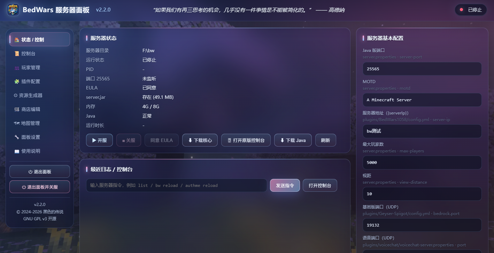

# 高版本经验起床一键开服包

> GitHub 仓库：`xpbedwars-server-pack`  
> Java 1.12 ~ 26.3 · 基岩版互通 · Paper 1.21.4

一套基于 BedWars1058 与 233BedWars 开发的高版本经验起床服务器整合包。还原布吉岛经典玩法的同时，加入地雷、烟花、毒液球、幸运方块、重锤等大量道具与高版本武器，并配套独立开服面板、队伍选择器和完整管理功能，开服和日常维护都更简单。

> 本仓库是原创代码、配置示例和文档仓库，**不包含**第三方插件 jar、Paper 核心、地图文件和玩家数据。  
> 开服请使用 Release 中的整合包，或将本仓库配置与官方插件自行组合。

---

## 功能特性

### 游戏玩法

- 经验起床模式：支持 4队8人 / 8队4人，适合 4~32 人参与
- 6 张内置地图：4 张 4队8人地图 + 2 张 8队4人地图
- 丰富道具：地雷、烟花、毒液球、幸运方块、重锤等
- 1.8 PvP：完全还原 1.8 PvP 机制
- 血量与战斗辅助
  - 进服与重生后保持 28 血上限
  - 指南针自动定位最近敌人并显示距离
  - 玩家头顶及 Tab 列表显示血量

### 队伍与社交

- 可视选队：队伍选择器直接查看人数、选择队伍
- `/zd` 组队：用法与布吉岛基本一致，输入 `/zd` 查看详情
- 游戏内组队：邀请好友同队，掉线后可重新加入对局
- 局部语音：集成语音聊天（端口 24454 UDP）
- 私聊系统：支持 `/tell` 私聊
- 全局喊话：`@!` 发送全局消息，也可使用 `/shout`

### 管理与安全

- 白名单系统：面板玩家管理直接添加，或控制台输入 `/wl add <name>`
- 封禁系统：使用 [AdvancedBanZ](https://modrinth.com/plugin/advancedbanz)，已集成到面板，可封禁 / 解封
- 登录系统：AuthMe 5.7.0，支持注册、登录、中文提示
- BW 等级经验系统：面板可查看等级、经验、升级所需
- 玩家皮肤：离线模式下还原 / 更换皮肤

### 兼容与跨平台

- 高版本兼容：ViaVersion / ViaBackwards 支持 1.12 ~ 1.26.3（理论 1.8 亦可，以 Via 实际支持为准）
- 基岩版互通：Geyser + Floodgate，基岩版玩家可加入，并显示 `[BE]` 前缀
- BE 玩家 UI（实验性）：为基岩版玩家提供适配界面

### 便捷操作

- 批量购买：Shift+左键 一次购买一组可堆叠物品
  - 末影珍珠 16 个，羊毛、箭、TNT、金苹果等 64 个
- 快捷购买栏：Shift+右键 保留快捷购买添加 / 移除
- 完整汉化：Tab、结算、快捷通讯、商店、资源点全息图等均已汉化

---

## 开服面板



内置独立开服面板，不需要安装 Python，解压后双击 `启动面板.exe` 即可使用。

| 模块 | 功能 |
|------|------|
| 开服 | 一键开服 / 关服，自动检测 server.jar、EULA、Java |
| 核心 | 面板内下载 Paper 1.21.4，不内置核心，需自行同意 EULA |
| 控制台 | 内置服务器控制台，可直接输入指令 |
| 玩家管理 | BW 等级、经验、升级所需、白名单、封禁 / 解封 |
| 插件更新 | 面板内更新 Geyser、Floodgate、ViaVersion、ViaBackwards |
| 配置编辑 | 端口、MOTD、server-ip、最大人数、视距、基岩版端口、语音端口、其他插件配置 |
| Java 环境 | 检测、切换、下载 Temurin 21 |
| 使用说明 | 内置开服流程、配置说明和常见问题 |
| BW 配置 | 修改生成器、升级配置、商店物品价格 |
| 退出管理 | 支持「退出面板」「退出面板并关服」 |
| 保存提醒 | 修改未保存、切换页面、退出面板都会提示 |

---

## 兼容与端口

| 项目 | 说明 |
|------|------|
| Java 版 | 1.12 ~ 1.26.3（理论 1.8 也可，以 Via 支持为准） |
| 服务器核心 | Paper 1.21.4 |
| 基岩版 | Geyser + Floodgate |
| Java 端口 | 25565 |
| 基岩版端口 | 19132（UDP） |
| 语音端口 | 24454（UDP） |

> 基岩版必须使用独立端口，不要和 Java 版共用。  
> 公网开服请映射 25565、19132、24454 三个端口。

---

## 快速开始

1. 解压到任意目录（**路径不要包含中文**）
2. 安装 **Java 21**
3. 双击根目录 `启动面板.exe`
4. 面板自动识别当前解压目录
5. 在面板中下载 **Paper 1.21.4** 核心
6. 同意 **EULA**
7. 点击「开服」
8. 控制台输出 `Done` 后即可进入游戏

### 手动开服（可选）

```text
# 下载 Paper 1.21.4，命名为 server.jar 放到根目录
# 双击 start.bat
# 默认分配 8GB 内存，可修改 -Xmx8G
```

---

## 注意事项

- 整合包**不内置** Paper 核心，需自行下载并同意 EULA
- 基岩版必须使用独立端口
- 1.8 仅理论兼容，实际以 Via 为准
- 指南针存在偶发抽风，属于已知问题
- BE UI 为实验性功能，建议实测
- 如遇插件报错，请先确认 Java 版本为 21

---

## 仓库说明

### 仓库结构

```text
.
├─ panel/                       # 面板源码
│  ├─ ServerPanel.py
│  ├─ PanelLauncher.cs
│  ├─ logo.png / logo.ico
│  ├─ panel_assets/
│  ├─ panel_config.example.json
│  └─ README.md
├─ configs/
│  ├─ BedWars1058/              # BW1058 配置示例
│  └─ 233BedWars/               # 233 配置示例
├─ plugins-src/
│  ├─ BWCompass/                # 自研指南针插件源码
│  ├─ BedWarsTeamSelector/      # 自研队伍选择器 / /zd 源码
│  └─ BETag/                    # 自研 BE 前缀插件源码
├─ forks/
│  └─ BedWars1058/              # BedWars1058 修改补丁与说明
├─ docs/
│  ├─ server-intro.md
│  ├─ configuration.md
│  ├─ faq.md
│  └─ changelog.md
├─ scripts/
│  └─ start.bat
├─ server.properties.example
├─ LICENSE
├─ NOTICE
├─ THIRD_PARTY_LICENSES.md
└─ README.md
```

### 配置开源范围


**公开的配置文件：**

- `BedWars1058/config.yml`
- `BedWars1058/shop.yml`
- `BedWars1058/generators.yml`
- `BedWars1058/upgrades2.yml`
- `BedWars1058/Languages/messages_zh_cn.yml`
- `BedWars1058/Addons/Compass/config.yml`
- `BedWars1058/Addons/TeamSelector/config.yml`
- `233BedWars/config.yml`
- `233BedWars/addons/*.yml`
- `server.properties.example`

详细说明见 [docs/configuration.md](docs/configuration.md)。

### 自研插件源码

以下三个插件由本项目自己维护，源码已放入 `plugins-src/`：

| 插件 | 功能 | 源码 |
|------|------|------|
| BWCompass | 最近敌人追踪、距离显示、快捷通讯 | [plugins-src/BWCompass](plugins-src/BWCompass) |
| BedWarsTeamSelector | 可视化选队 + `/zd` 组队 | [plugins-src/BedWarsTeamSelector](plugins-src/BedWarsTeamSelector) |
| BETag | 基岩版 `[BE]` 前缀 | [plugins-src/BETag](plugins-src/BETag) |

> 发布这些插件的编译 jar 时，请同时提供对应源码，以符合 GPLv3 要求。

---

## BedWars1058 修改版

BedWars1058 是在上游基础上修改过的版本，修改记录和补丁源码放在：

- [forks/BedWars1058](forks/BedWars1058)

包含：

- #1144 最终击杀报错修复
- #1142 相关兼容修复
- TNT 提示粒子报错修复
- Shift+左键买一组
- 护甲购买限制与死亡重置
- 28 血上限
- 铁锻炉升级相关修改

说明：

- 上游 BedWars1058 使用 GNU GPL v3
- 本仓库保留上游 `LICENSE`
- 实际发布修改后的 jar 时，需要同时提供完整的对应源码
- 补丁源码不是完整上游源码，不能单独替代 GPL 的“对应源码”义务

---

## 第三方插件与版权

本仓库**不包含**以下第三方插件 jar：

- 233BedWars
- Geyser-Spigot / Floodgate
- AuthMe
- LuckPerms / Vault
- ViaVersion / ViaBackwards
- PlaceholderAPI / ProtocolLib
- Simple Voice Chat
- Essentials
- AdvancedBanZ
- IpacWhitelist
- OldCombatMechanics

请从各自官方发布页下载，并遵守对应许可证。第三方插件版权归各自原作者所有。

地图文件可能涉及第三方地图作者版权，本仓库不附带地图，请在获得授权后自行使用。

---

## 贡献

欢迎提交 Issue 和 Pull Request。

提交前请确认：

1. 不包含玩家数据、日志、服务器密钥等敏感信息
2. 不包含未经授权的第三方插件 jar 或地图
3. 配置修改先在测试环境验证
4. 说明复现步骤和 Java / 客户端版本

---

## 开发说明

本项目的面板和部分插件由 **DeepSeek Harness** 辅助完成（ai生成内容加入于2.2.0的更新当中）。

所有改动均经过项目维护者人工检查、测试和调整后发布；AI 生成的内容可能存在错误，使用前请自行验证。

---

## 版权与鸣谢

本整合包基于 **GNU GPL v3** 协议开源，详见包内 `LICENSE` 与 `NOTICE`。  
第三方插件版权归各自原作者所有，详见 `THIRD_PARTY_LICENSES.md`。

**特别感谢：**

- 233BedWars 插件作者 **Serendipity**
- BedWars1058 作者 **andrei1058**
- 布吉岛经验起床服务器（玩法参考）
- 所有此前通过积分支持过本整合包的用户
- 所有提供反馈与测试的玩家

---

## 联系与赞助

- **QQ 群**：1129687526（问题反馈、公测通知）
- **MineBBS 原帖**：<https://www.minebbs.com/threads/50866/>
- **爱发电**：<https://ifdian.net/a/heisedechuanshuo>

本项目制作花费了大量时间成本，包括定做插件、修改配置与制作面板。  
如果你觉得项目对你有帮助，愿意支持持续开发和维护，欢迎赞助。

---

## 使用指南

📄 [高版本经验起床一键开服包使用指南（PDF）](docs/高版本经验起床一键开服包使用指南.pdf)
